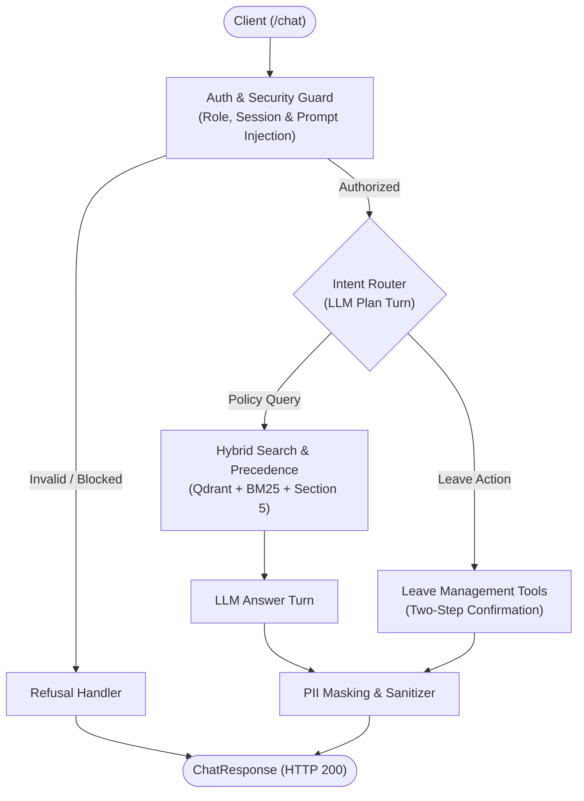

# Veltrix PeopleOps Assistant - System Architecture & Design

This document details the architectural decisions, security boundaries, and failure mitigations of the Veltrix PeopleOps Assistant per Section 11.1 of the evaluation specification.

---

## System Architecture

---

## 1. Document Ingestion & Document Processing
- **Unified Document Parser**: All corpus documents listed in the manifest are ingested automatically into structured Markdown format:
  - *PDF Documents*: Parsed with structural table detection to preserve tabular layouts, columns, and numeric boundaries cleanly.
  - *Word Documents (DOCX)*: Headings, bulleted lists, and tables are converted into standard Markdown.
  - *HTML Documents*: Semantic tags and tables are normalized into standard GitHub-flavored Markdown tables.
  - *Text & Markdown*: Ingested directly with UTF-8 encoding.
- **Table Structure Preservation**: Tabular policies (leave accrual schedules, insurance tiers, public holiday calendars) are converted into structured Markdown tables, preserving column alignment and headers so semantic relationships are maintained.
- **Scanned Document Processing**: Documents without native text layers (such as scanned internal memorandums) are processed with an optical character recognition (OCR) fallback. Extracted text is cached on disk to enable immediate, deterministic startup without requiring external vision API calls on every boot.
- **Calendar & Holiday Extraction**: Calendar documents are parsed during startup to extract public holidays by region, date, and holiday name, storing them in the relational database for working-day calculations.

---

## 2. Chunking & Hybrid Retrieval Design
- **Structure-Aware Chunking**: Documents are split into semantic units aligned with Markdown headings (H1, H2, H3), lists, and table blocks rather than arbitrary character splits. Tables remain intact within single chunks wherever possible. Each chunk is bounded to a maximum of 350 tokens and retains its document metadata, section headers, and hierarchical locator.
  - *Why Chosen*: Fixed-size character or token chunking splits tables across chunks, cuts numeric policies mid-sentence, and detaches paragraphs from their governing section headings. Structure-aware chunking preserves table integrity and ensures child paragraphs carry parent section context.
- **Hybrid Retrieval Strategy**:
  1. *Dense Semantic Search*: Powered by high-dimensional semantic vector embeddings indexed in a vector database, capturing natural language intent and conceptual similarity.
  2. *Sparse Keyword Search*: BM25 keyword scoring indexes exact terminology, policy IDs, numeric thresholds, and specific dates.
  3. *Reciprocal Rank Fusion (RRF)*: Dense and sparse retrieval ranks are combined ($k=60$) to ensure both conceptual relevance and exact keyword precision appear at the top of the candidate list.
  4. *Corpus Token Budget Packing*: Top-ranked chunks are packed greedily up to a 2,700-token ceiling, providing a safety margin below the strict 3,000-token context budget.
  - *Why Chosen*: Pure vector search struggles with exact alphanumeric identifiers (e.g., policy codes like `POL-REMOTE-WORK`, currency amounts, or specific dates), while pure keyword search fails on semantic paraphrasing (e.g., matching "home office allowance" to remote work rules). Hybrid search with RRF delivers the best of both without requiring cross-system score calibration.

---

## 3. Document Precedence Engine (Section 5)
When multiple documents provide rules on the same policy topic, candidate rules are resolved through a deterministic multi-stage precedence pipeline:
1. **Eligibility Evaluation**: A document is eligible only if:
   - The user's role matches the document's access level (`all`, `managers`, or `hr`).
   - The user's region matches the document's applicable region or the document is global.
   - The document's effective date is on or before the reference date (evaluated against the designated reference date or past date requested).
2. **Precedence Hierarchy**:
   - *Authority Rank*: Formal policies, addenda, memorandums, handbooks, and calendars strictly take precedence over wikis and informal FAQs.
   - *Scope Rank*: Regional documents (`IN`, `US`, `DE`) strictly override global documents.
   - *Recency*: When authority and scope are equal, documents with a later effective date supersede older ones.
3. **Unresolved Conflicts**: If multiple documents are tied on all criteria and their stated values differ, both values and their respective citations are surfaced with an explicit conflict flag.
4. **Upcoming Changes**: Valid future documents that would supersede current policy after the reference date are surfaced with an explicit notice, citation, and future effective date.

---

## 4. Leave Management & Two-Step Confirmation State Machine
- **Business Rule Validation**:
  - *Date Boundaries*: Rejects requests in the past, inverted date ranges, or dates outside the operational calendar year.
  - *Working Day Computation*: Calculates net working days by excluding Saturdays, Sundays, and regional public holidays active on the specific dates.
  - *Balance Checks*: Ensures requested days do not exceed the employee's available leave balance.
  - *Notice Requirements*: Rejects leave applications submitted beyond the maximum allowed advance booking window (6 months).
  - *Conflict Prevention*: Detects and rejects overlapping leave requests.
- **Two-Step Confirmation Lifecycle**:
  - *Step 1 (Proposal)*: The system validates parameters, calculates working days, and generates a structured pending proposal with a clear summary. No database mutation occurs at this stage, and the response indicates confirmation is required.
  - *Step 2 (Execution)*: Upon explicit affirmative confirmation (`"yes"` or `"confirm"`) within the same session, the system executes an atomic transaction that deducts the leave balance and records the request.
  - *Cancellation*: Replying negatively cancels and clears the proposal without modifying state.
- **Caller Scoping for State Changes**: Leave applications and cancellations can only be executed by the employee who owns the record. Managers cannot mutate leave records belonging to other employees.

---

## 5. Personal Identifiable Information (PII) Protection
- **Log Sanitation**: A centralized logging filter intercepts console and file logs. Phone numbers are redacted and email addresses are masked before writing to disk. Internal employee identifiers are logged in place of personal names.
- **Response Scrubbing**: All outgoing assistant messages pass through an automated privacy filter that strips detected phone numbers and masks personal email addresses.
- **Prompt Isolation**: Prompts provided to external model APIs contain only the caller's authorized context and role-filtered document chunks.

---

## 6. Failure Modes Identified & Mitigations
1. **Context Window Overflow**:
   - *Risk*: Unbounded document retrieval exceeding the 3,000-token corpus cap.
   - *Mitigation*: Hard token counting during retrieval packing, enforcing a 2,700-token cap with an automated gateway assertion that rejects oversized context payloads.
2. **Cold-Start Latency Breach**:
   - *Risk*: Re-ingesting, re-parsing, and re-embedding all corpus documents on service restart exceeding the startup time limit.
   - *Mitigation*: Disk-backed caching of parsed documents, pre-computed chunk representations, and persistent vector storage with binary quantization, enabling sub-second restarts.
3. **Indirect Prompt Injection**:
   - *Risk*: Untrusted text in documents containing adversarial instructions attempting to override system behavior.
   - *Mitigation*: Retrieved text is framed strictly as untrusted external reference data in prompts, complemented by a deterministic security guard that detects and refuses prompt injection attempts before invoking the model.
4. **Premature State Mutation**:
   - *Risk*: Autonomous model execution modifying database records based on ambiguous or speculative user input.
   - *Mitigation*: Enforced two-step confirmation state machine requiring explicit affirmative verification from the user before executing write transactions.

---

## 7. Scalability & Evolution to 10,000 Documents
- **Bottlenecks at 10,000 Documents**:
  - *In-Memory Inverted Indexing*: Storing and scoring 10,000 tokenized documents in application memory would lead to high memory consumption and elevated query latency.
  - *Sequential Ingestion*: Single-worker document processing would exceed acceptable startup and deployment timeframes.
  - *Linear Candidate Filtering*: Iterating over thousands of document metadata objects in application code would introduce CPU bottlenecks.
- **Target Architecture**:
  - *Distributed Vector & Sparse Indexing*: Offload sparse BM25 and dense vector search entirely to dedicated distributed search nodes, pushing filtering and ranking into indexed database engines.
  - *Asynchronous Ingestion Pipeline*: Decouple document parsing and embedding into a distributed queue-based worker pipeline (e.g., Celery or Temporal) processing documents in parallel from cloud object storage.
  - *Indexed Metadata Facets*: Index document metadata (authority tier, regional scope, effective dates, access levels) directly as database payload filters, ensuring pre-filtering scales logarithmically.
