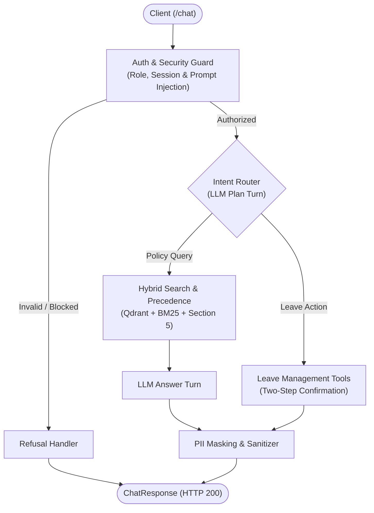

# Veltrix PeopleOps Assistant

AI HR assistant for Veltrix Systems. Answers company policy questions with deterministic Section 5 document precedence, manages leave requests through a two-step confirmation workflow, and enforces role-based access control (RBAC) and privacy rules.

---

## 1. Architecture



---

## 2. Quickstart

### Method A: Docker (Recommended)

1. **Clone and enter the repo:**
   ```bash
   git clone <your-repository-url>
   cd veltrix-peopleops-assistant
   ```

2. **Configure environment:**
   ```bash
   cp .env.example .env
   ```
   Open `.env` and set your `GEMINI_API_KEY` (see [Section 3: Environment Variables](#3-environment-variables)).

3. **Start services:**
   ```bash
   docker compose up --build
   ```
   * Qdrant runs on `http://localhost:6333`
   * API server runs on `http://localhost:8000`
   * All 30 corpus documents are automatically indexed on startup (~3 seconds).

4. **Verify health:**
   ```bash
   curl http://localhost:8000/health
   # Returns: {"status": "ok"}
   ```

5. **Send a test query:**
   ```bash
   curl -X POST http://localhost:8000/chat \
     -H "Content-Type: application/json" \
     -H "X-Employee-Id: E2004" \
     -d '{"session_id": "test_01", "message": "What is the annual leave allowance for employees in India?"}'
   ```
   Interactive Swagger docs are also available at [http://localhost:8000/docs](http://localhost:8000/docs).

---

### Method B: Manual Setup

1. **Prerequisites:** Python 3.12 and [uv](https://github.com/astral-sh/uv).

2. **Install dependencies:**
   ```bash
   uv sync
   ```

3. **Configure environment:**
   Create `.env` and set your `GEMINI_API_KEY` (see [Section 3: Environment Variables](#3-environment-variables)).

4. **Run offline tests (optional):**
   ```bash
   uv run pytest -v
   ```

5. **Start server:**
   ```bash
   uv run main.py
   ```

---

## 3. Environment Variables

Create `.env` in the project root:

```ini
CORPUS_DIR=./data/corpus
MANIFEST_PATH=./data/manifest.json
DB_PATH=./data/veltrix.db

QDRANT_URL=
QDRANT_API_KEY=

APP_TODAY=2026-10-20
LLM_PROVIDER=gemini

GEMINI_API_KEY=your_gemini_api_key_here
GROQ_API_KEY=
```

> **Data Directory:** The system automatically checks `./data` and `./veltrix_assessment` for `manifest.json`, `corpus/`, and `veltrix.db`. To point to a custom folder, pass `DATA_DIR=/path/to/data`.

---

## 4. Architectural Assumptions

1. **Uniform Permission Refusal:** Unauthorized reads for another employee's records return HTTP 200 with route `refuse` and the fixed message: `"I can't share information about that employee."` This prevents user enumeration.
2. **Conflict Resolution:** When multiple eligible documents have equal authority, scope, and effective date but conflicting values, both are returned with `conflict: true`.
3. **Scanned PDF OCR:** Scanned pages without a text layer (`memo_hybrid_work_update.pdf`) use pre-cached OCR text in `data/ocr_cache/` with Gemini Vision fallback.
4. **Calendar Precedence:** Public holidays are selected per region using Section 5 precedence rules (`effective_date <= APP_TODAY`).

---

## 5. Known Limitations

1. **In-Memory Sessions:** Turn history and pending proposals reside in memory (`SessionService`). A distributed multi-instance deployment would require Redis.
2. **Year Boundary:** Leave balances and working days logic are scoped to calendar year 2026 per project specifications.
